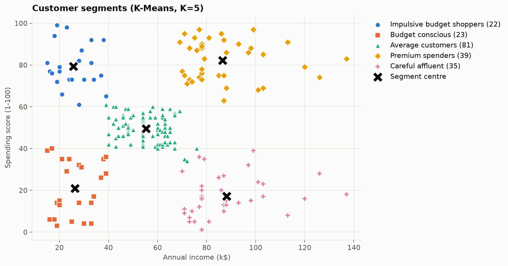
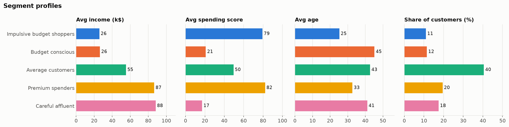
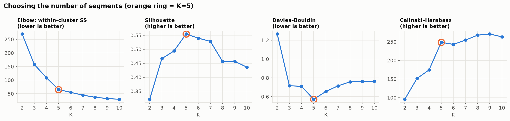
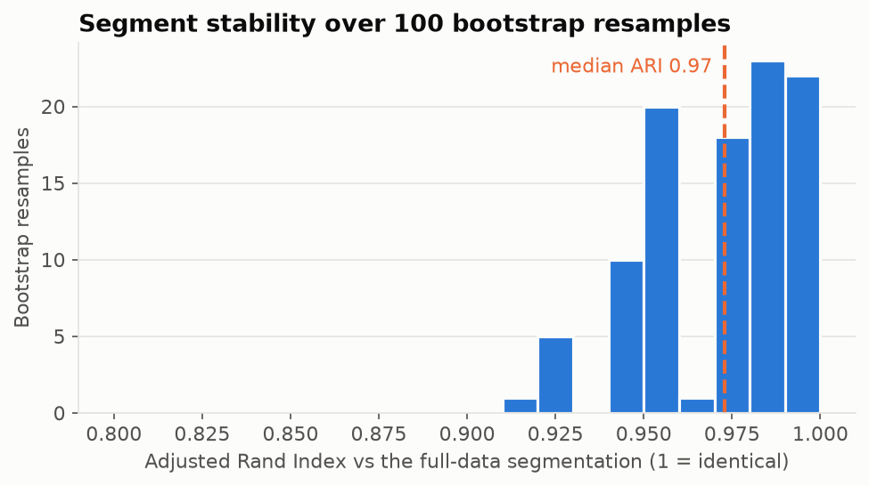
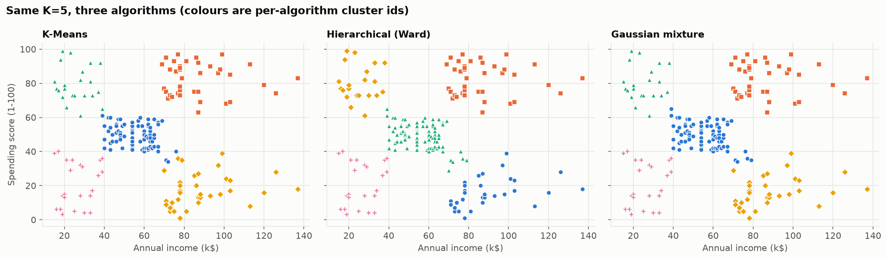

# Customer Segmentation with K-Means


Segments 200 mall customers by **annual income** and **spending score** into five groups a marketing team can act on. Unlike most K-Means tutorials, it also checks that the segments are real: the number of clusters is chosen with four criteria, stability is tested on 100 bootstrap resamples, and two other algorithms are compared.

👉 **Full walkthrough with all outputs:** [`notebooks/customer_segmentation.ipynb`](notebooks/customer_segmentation.ipynb)



## The five segments

| Segment | Customers | Avg income | Avg spending score | Avg age | Suggested action |
|---|---:|---:|---:|---:|---|
| **Premium spenders** | 39 (19.5%) | $86.5k | 82 | 33 | Loyalty / VIP programme, early access, premium lines |
| **Careful affluent** | 35 (17.5%) | $88.2k | 17 | 41 | Find out why they hold back: quality, service, personalised offers |
| **Average customers** | 81 (40.5%) | $55.3k | 50 | 43 | Standard campaigns; upsell toward premium |
| **Impulsive budget shoppers** | 22 (11.0%) | $25.7k | 79 | 25 | Promotions and bundles; watch credit/returns risk |
| **Budget conscious** | 23 (11.5%) | $26.3k | 21 | 45 | Value ranges, discount days, low-cost retention |

Segment names come from each cluster's income and spending level relative to the whole customer base (bottom, middle or top third), so they are assigned by rule, not by hand.



**Two segments worth a closer look:**
- **Careful affluent** customers earn as much as Premium spenders but spend about a fifth as much. They are the biggest untapped opportunity.
- **Impulsive budget shoppers** are the youngest group (about 25) and spend like the richest customers on a quarter of the income.

## How the segments were validated

### 1. Choosing K: four criteria, not just the elbow



| K | Silhouette ↑ | Davies–Bouldin ↓ | Calinski–Harabasz ↑ |
|---|---|---|---|
| 4 | 0.494 | 0.710 | 174.6 |
| **5** | **0.555** | **0.572** | 248.6 |
| 6 | 0.540 | 0.655 | 243.1 |

Silhouette and Davies–Bouldin both pick **K = 5**, and the elbow bends there. Calinski–Harabasz keeps creeping up to K = 9 (it tends to favour more clusters) but jumps the most at 5.

Adding **age** as a third feature made the structure weaker (best silhouette 0.43 instead of 0.55, and the indices disagree on 6 vs 7), so age is reported per segment instead of being clustered on.

### 2. Stability: do the segments survive resampling?

K-Means was refitted on **100 bootstrap resamples** of the customers. Each result was compared with the full-data segmentation using the Adjusted Rand Index (1 = identical).



Median ARI **0.97** (5th percentile 0.93): the same five segments come back almost every time.

### 3. Do other algorithms agree?

| Algorithm | Silhouette | Davies–Bouldin | Agreement with K-Means (ARI) |
|---|---|---|---|
| K-Means | 0.555 | 0.572 | 1.00 |
| Hierarchical (Ward) | 0.554 | 0.578 | 0.94 |
| Gaussian mixture | 0.554 | 0.576 | 0.96 |



Three different methods find essentially the same five groups. The few disagreements are customers on the border between *Average customers* and the corner segments.

## Assign new customers

```bash
python -m segmentation.predict --income 90 --spending 85 --income 25 --spending 15 --income 60 --spending 50 --income 100 --spending 10
```

```
 income_k  spending_score  cluster           segment
     90.0            85.0        1  Premium spenders
     25.0            15.0        4  Budget conscious
     60.0            50.0        0 Average customers
    100.0            10.0        3  Careful affluent
```

The saved model (`models/kmeans_segments.joblib`) is a scikit-learn pipeline (`StandardScaler` → `KMeans`) plus the segment names. Every customer's segment is in [`reports/customer_segments.csv`](reports/customer_segments.csv).

## Project structure

```
├── segmentation/
│   ├── data.py        # Load and tidy the dataset
│   ├── analysis.py    # K selection, bootstrap stability, algorithm comparison
│   ├── profiles.py    # Segment profiles and rule-based persona names
│   ├── plots.py       # Figures
│   ├── run.py         # Runs everything -> reports/, models/
│   └── predict.py     # Assign new customers to segments
├── notebooks/
│   ├── customer_segmentation.ipynb   # Full analysis with outputs
│   └── 00_original_class_demo.ipynb  # The original classroom version
├── data/mall_customers.csv
├── models/kmeans_segments.joblib
├── reports/           # Figures, segment profiles, summary.json, customer_segments.csv
└── tests/
```

## Quickstart

```bash
git clone https://github.com/arslanahmedbhutto/customer-segmentation-kmeans.git
cd customer-segmentation-kmeans
python -m venv .venv
source .venv/bin/activate          # Windows: .venv\Scripts\activate
pip install -r requirements.txt
python -m segmentation.run         # regenerates reports/ and models/ (~10 s)
pytest
```

## Limitations

- 200 customers from a single mall, so the segments describe this customer base only.
- The spending score is defined by the mall and its formula isn't published.
- A single snapshot: there's no purchase history, so segments can't show how customers move between groups over time. RFM (recency, frequency, monetary) features would make this much stronger.

## Data

[Mall Customer Segmentation Data](https://www.kaggle.com/datasets/vjchoudhary7/customer-segmentation-tutorial-in-python) (Kaggle).

## Tech stack

Python · scikit-learn · pandas · matplotlib · Jupyter · pytest · GitHub Actions
